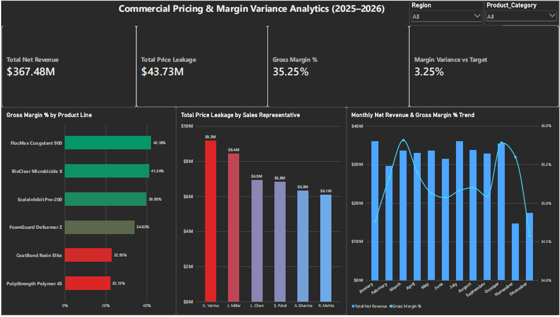

# Commercial Pricing & Margin Variance Analytics (2025–2026)

## 1. Business Objective
In B2B specialty chemicals and industrial manufacturing, aggressive ad-hoc discounting can quietly erode gross profit even when top-line revenue appears strong. This project analyzes **5,000 B2B commercial transactions ($367.48M Net Revenue)** across global regions using **SQL, Excel, and Power BI (DAX)** to quantify price leakage, evaluate product-mix profitability against a **32.0% Gross Margin target**, and identify high-discounting sales representatives.

---

## 2. Executive KPI Summary
- **Total Net Revenue:** `$367.48M` across 5,000 B2B orders
- **Total Price Leakage:** `$43.73M` lost to order discounting (`~10.6%` average discount rate)
- **Overall Gross Margin %:** `35.25%` (`+3.25%` above the `32.0%` corporate target)

---

## 3. Key Analytical Findings
1. **Product-Mix Margin Divergence:**
   - **High-Margin Core Lines:** *Water Treatment* products (*FlocMax Coagulant 900* at `42.18%`, *BioClear Microbicide X* at `41.24%`, and *ScaleInhibit Pro-200* at `39.90%`) consistently outperformed the 32% margin benchmark.
   - **Margin-Eroding Lines:** *Paper & Packaging* products (*CoatBond Resin Elite* at `22.95%` and *PulpStrength Polymer 45* at `22.13%`) fell nearly **10 percentage points below target** due to heavy discounting.
2. **Sales Representative Discount Concentration:**
   - Two representatives—**K. Verma (`$9.2M` leakage)** and **J. Miller (`$8.4M` leakage)**—accounted for a disproportionately high share of unapproved `>15%` discount leakage compared to peers (`$6.0M–$6.5M`).
3. **Monthly Margin Volatility:**
   - While monthly net revenue remained steady around `$15M–$18M`, gross margin percentages dipped noticeably during promotional quarter-end months where discount exceptions spiked.

---

## 4. Actionable Business Recommendations
- **Enforce Discount Approval Guardrails:** Require regional manager sign-off for any discount exceeding `12%` on *Paper & Packaging* SKUs to recover an estimated **`$8M–$11M`** in annualized gross margin.
- **Align Sales Incentives with Gross Margin:** Transition sales commission structures from top-line Net Revenue to **realized Gross Margin %** to discourage unnecessary price concessions.
- **Target Account-Level Price Recovery:** Audit the top 10 high-discount accounts identified in the SQL audit script during contract renewals.

---

## 5. Repository Structure & Tools Used
- **`Commercial_Pricing_Margin_Dashboard.pbix`** — Interactive Power BI Desktop report featuring custom DAX measures (`Gross Margin %`, `Margin Variance vs Target`, `Total Price Leakage`), conditional gradient formatting, and dynamic `Region` & `Product_Category` slicers.
- **`pricing_margin_analysis.sql`** — Five SQL queries covering executive KPI aggregation, product-mix variance vs. target, unapproved `>15%` discount audits, top 10 margin-eroding accounts, and monthly margin trends.
- **`solenis_commercial_pricing_data.csv`** — Structured 5,000-row B2B commercial pricing and cost dataset (`Order_ID`, `Region`, `Sales_Rep`, `Product_Category`, `List_Unit_Price`, `Discount_Pct`, `Net_Revenue`, `COGS`, `Freight_Cost`, `Gross_Margin`).
- **`dashboard_preview.png`** — High-resolution preview of the completed Power BI report.

---

## Author
**Surendra Kumar Yanamala** — Data Analyst (SQL | Power BI | Advanced Excel | Python)  
[LinkedIn](https://linkedin.com) • [GitHub](https://github.com)
